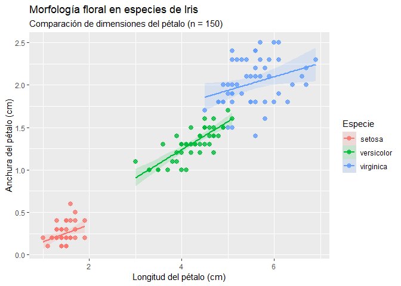
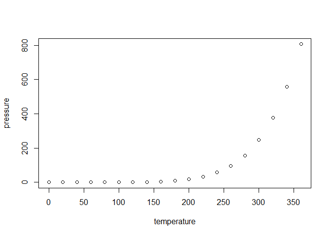

index
================
Rosalía de Castro
2026-11-26

- [1 Relación entre longitud y anchura del pétalo en
  *Iris*](#1-relación-entre-longitud-y-anchura-del-pétalo-en-iris)
- [2 Including Plots](#2-including-plots)

holiiiii , actualizacion 26-11 a las 20:25 hola caracola

# 1 Relación entre longitud y anchura del pétalo en *Iris*

# 2 Including Plots

Figura 1. Relación entre la longitud y la anchura del pétalo según la
especie de Iris

You can also embed plots, for example:

<!-- -->

Note that the `echo = FALSE` parameter was added to the code chunk to
prevent printing of the R code that generated the plot.
